<div align="center">


# SmartHire

**Your AI interview coach.** Practice real technical, behavioral and situational interview questions, answer by voice or text, and get instant, specific feedback on what to improve.

[](https://github.com/sadiqqgavvi-gif/smarthire/actions/workflows/ci.yml)
[](https://smarrthire.netlify.app/)


### 🔗 [Try it live → smarrthire.netlify.app](https://smarrthire.netlify.app/)

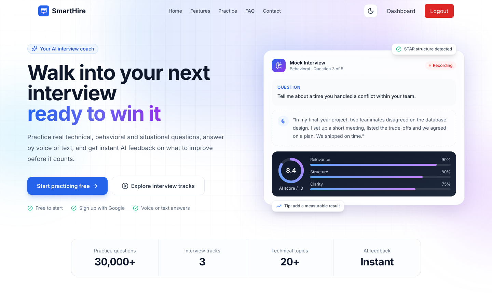

</div>

## Table of Contents

- [Highlights](#highlights)
- [Features](#features)
- [Screenshots](#screenshots)
- [How Answer Evaluation Works](#how-answer-evaluation-works)
- [Tech Stack](#tech-stack)
- [Project Structure](#project-structure)
- [Getting Started](#getting-started)
- [Environment Variables](#environment-variables)
- [API Overview](#api-overview)
- [Testing](#testing)
- [Deployment](#deployment)
- [Roadmap](#roadmap)
- [About This Project](#about-this-project)
- [License](#license)

## Highlights

| | |
| --- | --- |
| 🎯 **30,000+ questions** | 10,000 each for technical, behavioral and situational interviews, across 20+ technologies |
| 🧠 **Five-criteria scoring** | Relevance, depth, structure (STAR for behavioral), clarity and examples, weighted per interview type |
| 📚 **1,231 reference answers** | Technical answers are compared with an answer key: missing concepts and a model answer are shown |
| 🎙️ **Voice mock interviews** | Questions read aloud, answers by microphone, answer timer and speaking pace (words per minute) |
| 📈 **Progress dashboard** | Category scores, progress-over-time chart, practice streak and full session history |
| 🌗 **Light & dark mode** | A polished, animated, fully responsive interface that respects reduced-motion settings |

## Features

### Practice & mock interviews
- **Three interview tracks:** Technical, Behavioral and Situational.
- **Practice sessions:** choose Easy, Medium or Hard difficulty and 5, 10, 15 or 20 questions, then answer at your own pace with feedback on every question.
- **Mock interviews:** 10 questions, one at a time, in an interviewer-style flow with a progress bar, **skip question**, a results screen with a **per-question breakdown**, and one-click save to the dashboard.
- **Voice mode** (Web Speech API): live transcription of your spoken answer, with questions and feedback read aloud.
- **Answer timer and speaking pace:** every mock answer is timed (aim for 1–2 minutes), and spoken answers get a words-per-minute pace check (120–160 wpm is ideal).

### Smart answer evaluation
- Every answer is scored out of 10 on **relevance, depth, structure, clarity and examples**, and each criterion is shown as a bar.
- **Behavioral answers** are checked for the STAR structure (Situation, Task, Action, Result), and the feedback names the missing parts.
- **Situational answers** are checked for a first step, communication, analysis and follow-through.
- **Technical answers** are compared with a reference answer from the question bank. The feedback shows the concepts you missed ("Try to mention") and lets you open a **model answer**.
- Filler words are detected, for example "um", "basically" or "you know".
- Guardrails cap scores for answers that are off-topic, too short or nonsensical.
- An AI model (OpenAI) can be switched on for richer written feedback. Without it, the built-in engine still gives specific, reliable scores.

### Progress tracking
- **Overall, mock and practice views**, with score by category.
- A **progress over time** chart and a **practice streak** counter.
- A **session history** table showing date, type, category, difficulty, answers and score.

### Accounts & security
- **One "Get started" entry point** with Sign up / Log in tabs.
- **Google sign-in** (an account is created automatically on first use) or email and password.
- bcrypt-hashed passwords, plus short-lived JWT access tokens with rotating refresh tokens in httpOnly cookies. A Bearer-token fallback keeps login working in browsers that block third-party cookies.
- Helmet, a strict CORS allow-list, per-route rate limiting, request validation and structured logging with request IDs.

### Experience & design
- A cinematic landing page:
  - the hero types out a sample answer and then "scores" it
  - stats count up
  - a topic marquee scrolls under the hero
  - every section is revealed on scroll
- **Light and dark mode**, remembered per browser and defaulting to the system setting, with no flash on load.
- Fully responsive from phone to desktop. All animation is disabled for users who prefer reduced motion.

### Engineering
- **Resilient backend:** question routes keep working without the database by falling back to the bundled question bank, and `/health/ready` reports exactly why MongoDB is unavailable.
- **Docker:** Docker Compose for the full stack, with a non-root backend image and an unprivileged Nginx frontend.
- **CI:** GitHub Actions runs the backend and frontend test suites on every push and pull request.

## Screenshots

> The dashboard and results screens below use sample session data. Feedback scores were produced by the real SmartHire evaluation engine.

### Landing page

| Light mode | Dark mode |
| --- | --- |
|  | 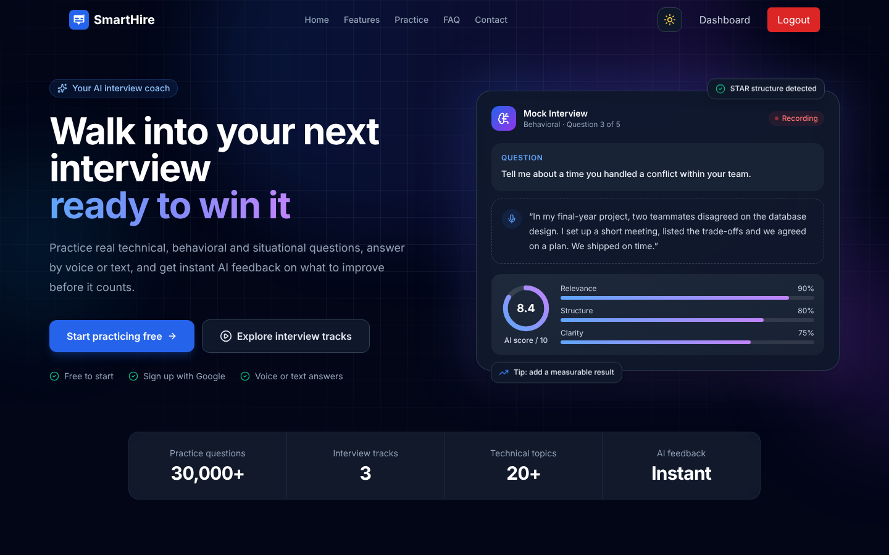 |

| Features | Interview tracks |
| --- | --- |
| 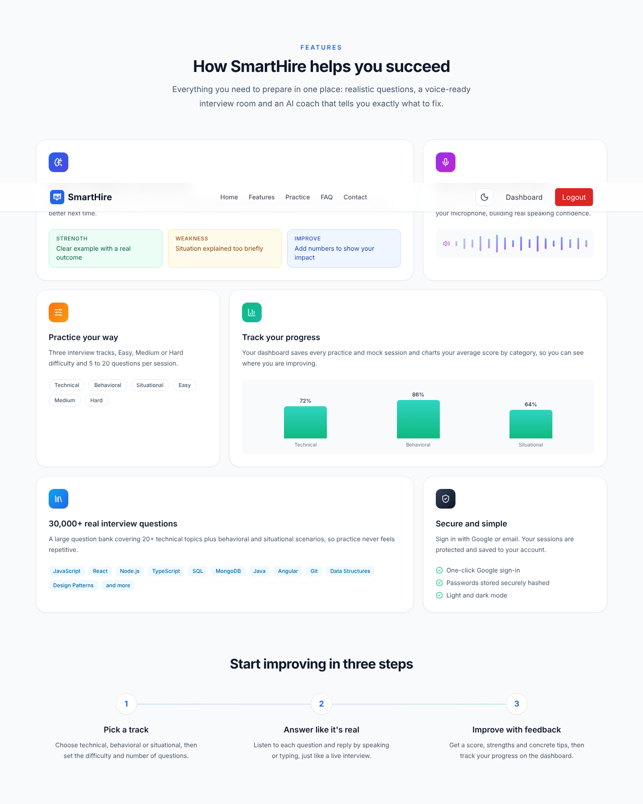 | 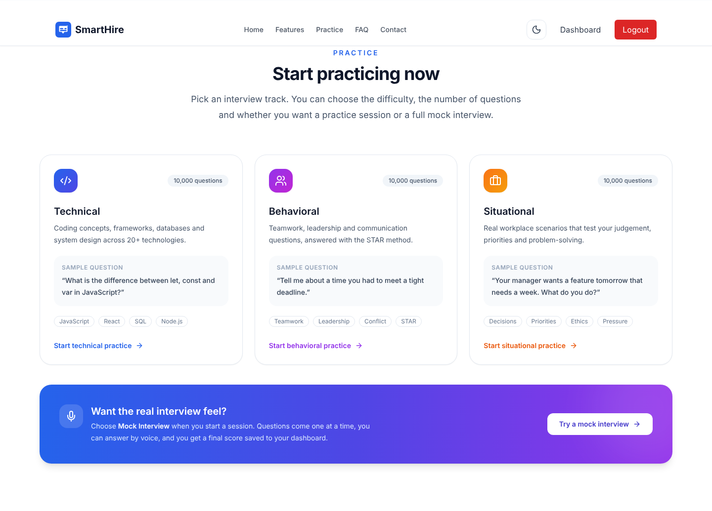 |

| FAQ | Contact |
| --- | --- |
| 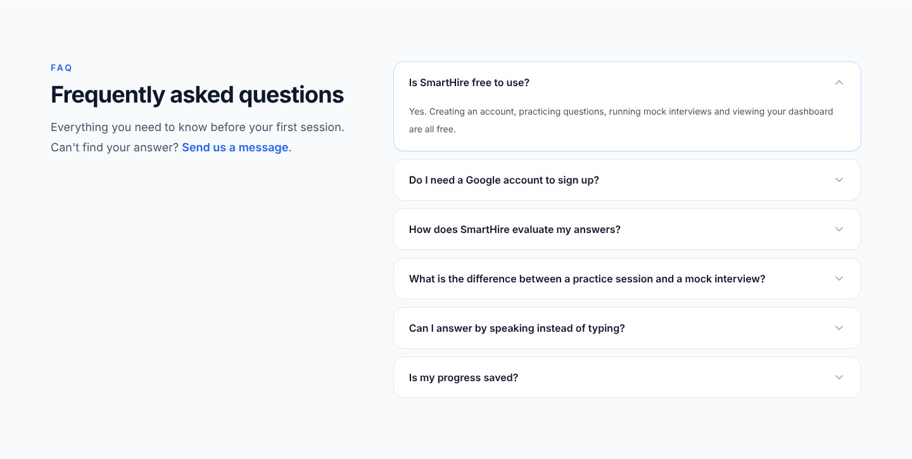 | 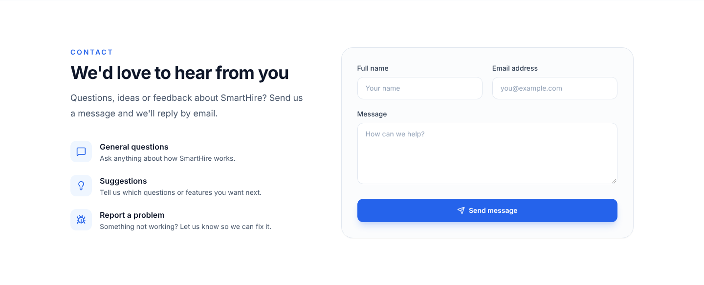 |

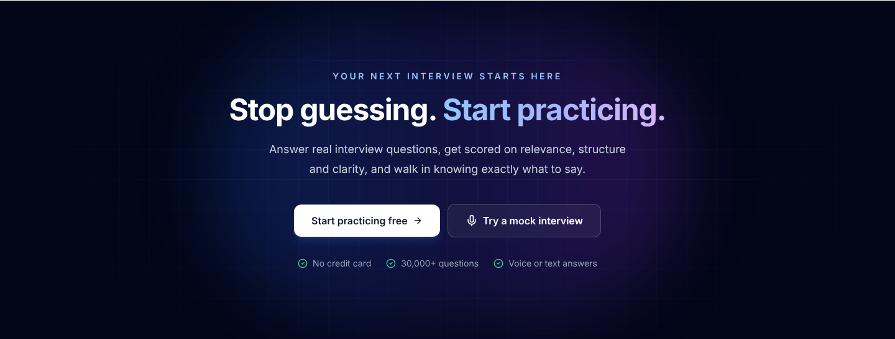

### Sign up & log in

| Get started (sign up) | Log in (dark mode) |
| --- | --- |
| 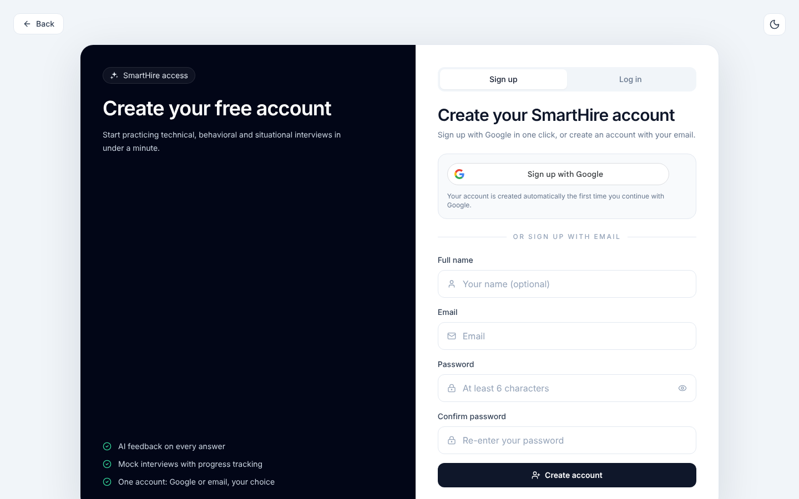 | 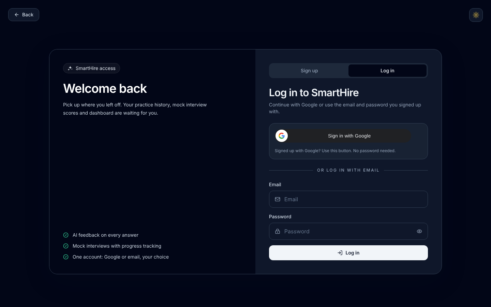 |

### Practice

| Configure a session | Practice feedback with model answer |
| --- | --- |
| 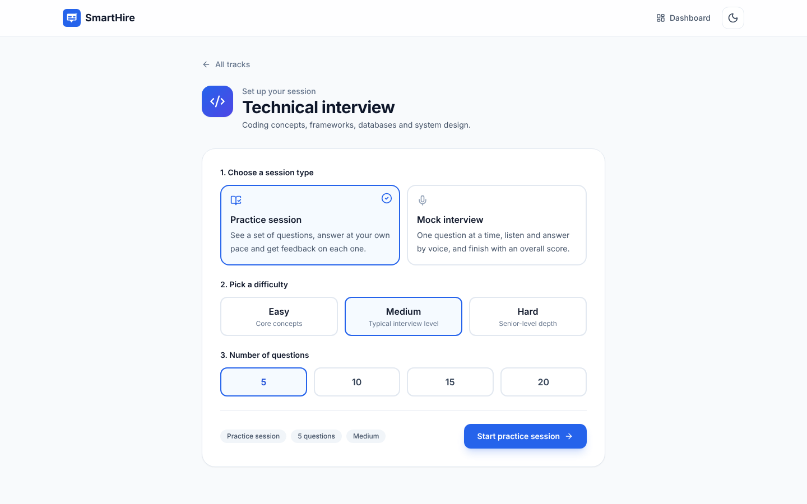 | 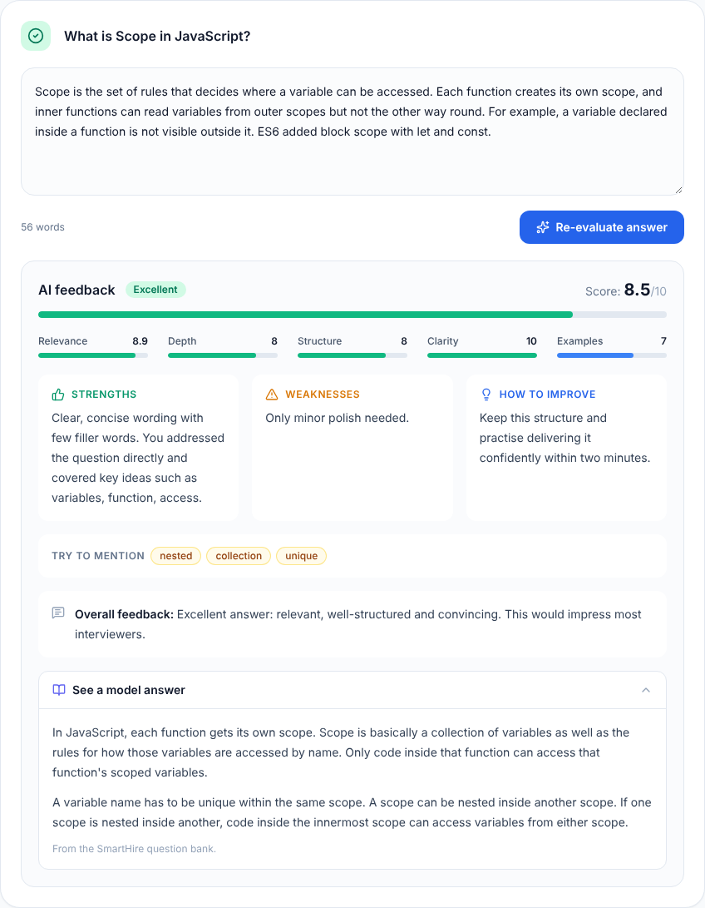 |

### Mock interview

| Interview in progress | AI feedback (STAR answer) | Results |
| --- | --- | --- |
| 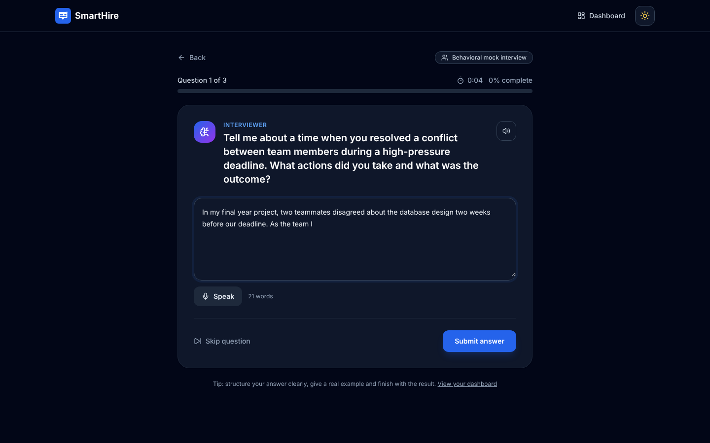 | 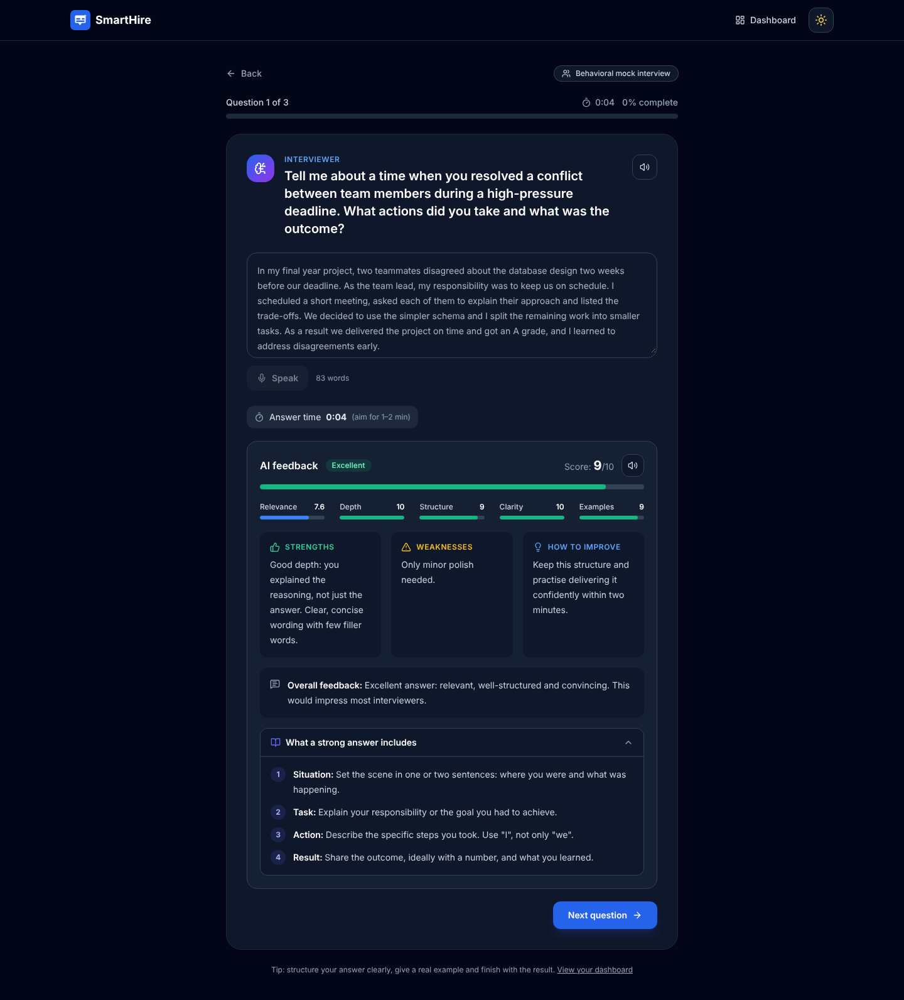 | 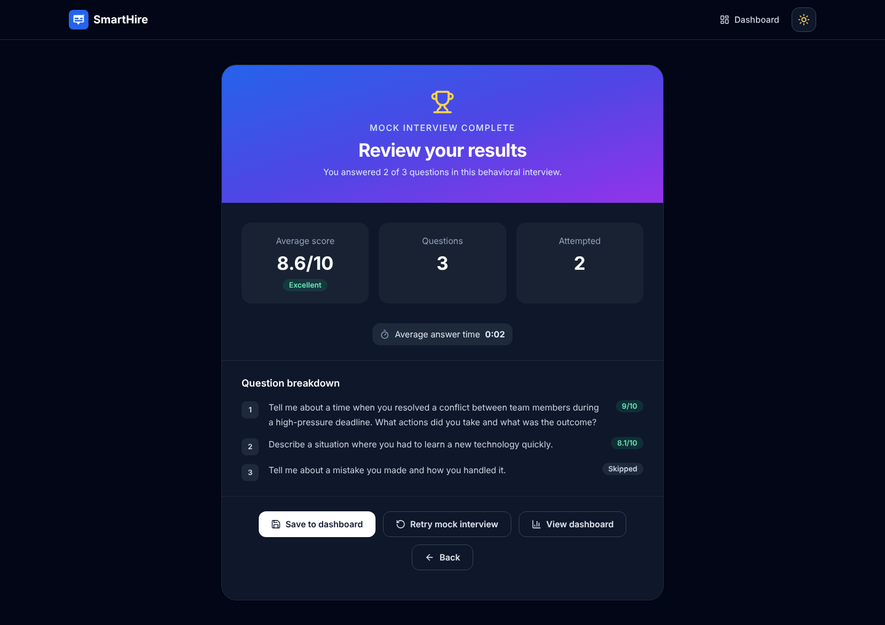 |

### Dashboard

| Light mode | Dark mode |
| --- | --- |
| 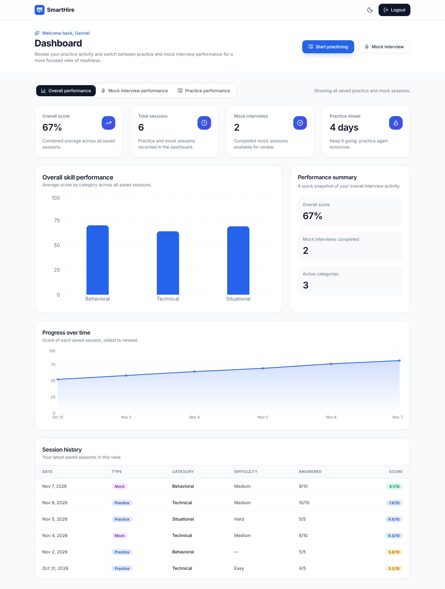 | 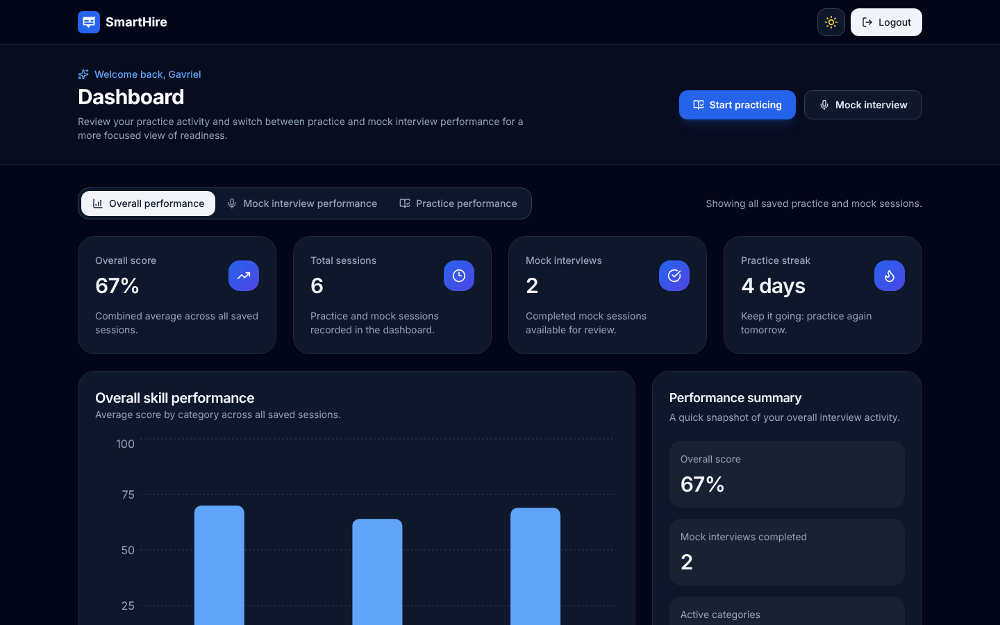 |

### Mobile


## How Answer Evaluation Works

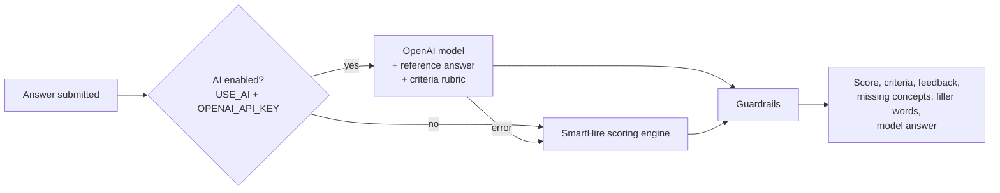

**1. Context.** For each question SmartHire looks up a **reference answer**. 1,231 question/answer pairs are parsed from the curated topic Markdown files (`utils/referenceAnswers.js`), and expected keywords are added from the database when it is available.

**2. Scoring.** Each answer gets five criterion scores (0–10). They are combined with weights that depend on the interview type:

| Criterion | What it measures | Technical | Behavioral | Situational |
| --- | --- | :-: | :-: | :-: |
| Relevance | Covers the question and the reference answer's key concepts | 35% | 20% | 25% |
| Depth | Substance and reasoning (*because*, *trade-off*, *however*…) | 25% | 10% | 20% |
| Structure | Definition → details for technical, **STAR** for behavioral, first step → communicate → decide → follow up for situational | 10% | 35% | 30% |
| Clarity | Sentence length, repetition and filler words | 15% | 15% | 15% |
| Examples | Concrete examples, numbers, code or named tools | 15% | 20% | 10% |

**3. Feedback.** Strengths come from the strongest criteria, and weaknesses and the improvement tip from the weakest. The feedback is specific to the answer: it names missing concepts, missing STAR parts and filler words.

**4. Guardrails.** Answers that are too short, off-topic or gibberish are capped (≤ 2–3/10), so keyword-stuffing or rambling cannot inflate a score.

**5. Optional AI.** With `USE_AI=true` and an `OPENAI_API_KEY`, an OpenAI model writes the feedback. It also receives the reference answer and returns the same five criteria. If the call fails, the engine above is used automatically. An optional Python evaluator (`USE_PYTHON_EVALUATOR=true`) is also supported.

Examples from the calibration tests (`smarthire-server/tests/smart.evaluator.test.js`):

| Answer | Score |
| --- | :-: |
| Correct closure explanation with an example | ~8/10 |
| Full STAR story with a measurable result | ~8.6/10 |
| Filler-heavy answer ("um, basically, you know…") | ≤ 4/10 |
| One-line answer | ≤ 2/10 |
| Off-topic answer | ≤ 2/10 |

## Tech Stack

**Frontend**
- React 19 + Vite 7
- Tailwind CSS 3 (class-based dark mode)
- React Router 7
- Recharts
- lucide-react icons
- Axios
- Vitest + React Testing Library

**Backend**
- Node.js + Express 5
- MongoDB + Mongoose 8
- JWT + bcryptjs
- Helmet, CORS, express-rate-limit
- OpenAI SDK (optional)
- Python 3 evaluator (optional)
- Node's built-in test runner

**DevOps**
- Docker + Docker Compose
- GitHub Actions CI
- Netlify (frontend)
- Vercel serverless (backend)
- MongoDB Atlas

## Project Structure

```
smarthire/
├── SmartHire/                       # React + Vite frontend
│   ├── public/                      # Logo / favicon
│   └── src/
│       ├── components/              # Hero, TopicMarquee, Features, Practice, FAQ, Contact, FinalCTA, ThemeToggle
│       │   ├── app/                 # AppHeader, FeedbackPanel, score tones, track metadata
│       │   └── motion/              # Reveal (scroll animation), CountUp, useInView
│       ├── layout/                  # Navbar, Footer
│       ├── pages/                   # Auth, ConfigurePractice, PracticeSession, MockInterview, Dashboard
│       ├── routes/                  # ProtectedRoute
│       ├── theme/                   # ThemeProvider (light / dark mode)
│       ├── utils/                   # authFetch, auth token fallback, error messages, session stats
│       └── tests/                   # Vitest + Testing Library specs
├── smarthire-server/                # Express + MongoDB backend
│   ├── routes/ controllers/         # /api/auth, /api/questions, /api/practice, /api/mock, /api/ai, /api/contact
│   ├── services/                    # smartEvaluator (scoring engine), aiEvaluationService, guardrails, python bridge
│   ├── utils/                       # database, questionBank, referenceAnswers, questionExtractor
│   ├── models/                      # User, Question, PracticeSession, Message
│   ├── middleware/                  # auth, validation, rate limiting, observability
│   ├── topics/                      # Markdown question banks + reference answers
│   ├── python/                      # evaluate_answer.py (optional evaluator)
│   └── tests/                       # Node test runner specs
├── screenshots/                     # Images used in this README
├── fyp_report_media/                # UML / architecture diagrams for the FYP report
├── docker-compose.yml
├── DEPLOYMENT.md                    # Atlas + Vercel + Netlify guide and troubleshooting
└── .github/workflows/ci.yml
```

## Getting Started

### Prerequisites
- Node.js 20+ and npm
- MongoDB: a local install, Docker, or a free [MongoDB Atlas](https://www.mongodb.com/atlas) cluster
- Python 3, only if you set `USE_PYTHON_EVALUATOR=true`

### 1. Clone

```bash
git clone https://github.com/sadiqqgavvi-gif/smarthire.git
```

```bash
cd smarthire
```

### 2. Fastest path: Docker Compose

```bash
docker compose up --build
```

This starts:
- the frontend at `http://localhost:5173`
- the API at `http://localhost:5000`
- MongoDB at `mongodb://localhost:27017`

### 3. Manual setup

**Backend.** Create `smarthire-server/.env` (see [Environment Variables](#environment-variables)), then install and start:

```bash
cd smarthire-server
```

```bash
npm install
```

```bash
npm start
```

**Frontend.** Create `SmartHire/.env`, then install and start the dev server:

```bash
cd SmartHire
```

```bash
npm install
```

```bash
npm run dev
```

Open `http://localhost:5173`.

### Rebuild the question dataset (optional)

```bash
cd smarthire-server
```

```bash
npm run build:practice
```

`npm start` also runs this automatically. Use `npm run generate:questions` to regenerate the Markdown question banks.

## Environment Variables

**Backend (`smarthire-server/.env`)**

| Variable | Required | Description |
| --- | :-: | --- |
| `MONGO_URI` | ✅ | MongoDB connection string, e.g. `mongodb://127.0.0.1:27017/smarthire` |
| `JWT_SECRET` | ✅ | Secret for signing session tokens |
| `ACCESS_TOKEN_SECRET` / `REFRESH_TOKEN_SECRET` | | Separate token secrets (default: `JWT_SECRET`) |
| `GOOGLE_CLIENT_ID` | | Enables Google sign-in (must match the frontend) |
| `CLIENT_ORIGINS` | | Comma-separated allowed frontend URLs |
| `NODE_ENV` | | `production` enables cross-site secure cookies |
| `USE_AI` + `OPENAI_API_KEY` | | Turn on AI-written feedback (`OPENAI_EVALUATION_MODEL` defaults to `gpt-4o-mini`) |
| `USE_PYTHON_EVALUATOR`, `PYTHON_BIN` | | Optional Python evaluator |
| `PORT` | | API port (default `5000`) |

**Frontend (`SmartHire/.env`)**

| Variable | Description |
| --- | --- |
| `VITE_API_URL` | Backend URL, e.g. `http://localhost:5000` |
| `VITE_GOOGLE_CLIENT_ID` | Google OAuth client ID (same as the backend) |

## API Overview

| Method | Endpoint | Description |
| --- | --- | --- |
| POST | `/api/auth/register` | Create an account (name, email, password) |
| POST | `/api/auth/login` | Log in with email + password |
| POST | `/api/auth/google` | Sign in / sign up with Google (`isNewUser` in the response) |
| GET | `/api/auth/me` | Current user _(protected)_ |
| POST | `/api/auth/refresh` | Rotate the access and refresh tokens |
| POST | `/api/auth/logout` | End the session |
| GET | `/api/questions` | Questions by `category`, `difficulty`, `role`, `count` |
| GET | `/api/practice/:type` | Questions for a practice / mock session |
| POST | `/api/practice/sessions` | Save a session _(protected)_ |
| GET | `/api/practice/sessions/me` | Dashboard stats and history _(protected)_ |
| GET | `/api/mock/:category` | Randomized mock interview question set |
| POST | `/api/ai/evaluate` | Evaluate a practice answer (score, criteria, feedback, reference answer) |
| POST | `/api/mock/evaluate` | Evaluate a mock interview answer |
| POST | `/api/contact` | Submit the contact form |
| GET | `/health/live` | Liveness probe |
| GET | `/health/ready` | Readiness probe: MongoDB status, the reason it is down, and config checks |

Question and evaluation routes keep working if MongoDB is unavailable: they use the bundled question bank.

## Testing

```bash
cd smarthire-server
```

```bash
npm test
```

```bash
cd SmartHire
```

```bash
npm test
```

- **Backend (41 tests):**
  - auth sessions
  - API validation
  - question extraction
  - database diagnostics
  - question fallback without a database
  - evaluation guardrails
  - scoring-engine calibration
- **Frontend (30 tests):**
  - auth and sign-up flows
  - protected routes
  - practice and mock interview flows
  - feedback panel
  - dashboard
  - theme toggle
  - contact form and FAQ
  - streak calculation

GitHub Actions runs both suites on every push and pull request.

## Deployment

- **Docker Compose:** MongoDB, the backend and an Nginx-served frontend in one command. Good for a VPS or a local demo.
- **Free tier (live setup):** MongoDB Atlas, the backend on Vercel (`smarthire-server/api/index.js`) and the frontend on Netlify.

[`DEPLOYMENT.md`](./DEPLOYMENT.md) has the step-by-step setup, the environment variables for each platform, and a troubleshooting table for every `/health/ready` reason (for example a paused Atlas cluster).

## Roadmap

- Resume-based, personalised question generation
- Downloadable PDF reports for each interview session
- Admin panel for managing the question bank
- Role-specific tracks (frontend, backend, QA, data)
- Password reset and email verification
- Optional video and body-language analysis (pending ethical review)

## About This Project

SmartHire began as a Final Year Project (BS Software Engineering) by **Gavriel Sadiq**, supervised by Ms. Iram Rubab, Department of Software Engineering, PMAS-Arid Agriculture University Rawalpindi. The UML diagrams (`SmartHire_UML_Diagrams.docx`) and architecture figures (`fyp_report_media/`) are included in the repository.

## License

This project is open source and available for review as part of my portfolio.
